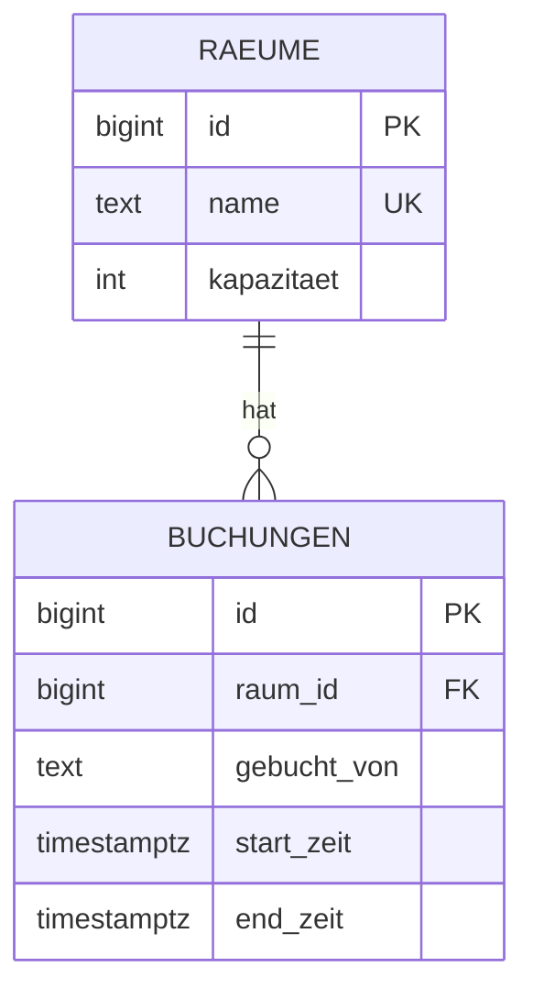

# Raumbuchung mit Konfliktschutz

Spring-Boot-Backend zur Buchung von Lernräumen. Doppelbuchungen werden von PostgreSQL selbst verhindert, auch bei gleichzeitigen Anfragen.

## Technologien

Java 21, Spring Boot, Spring Data JPA, PostgreSQL 16, Flyway, Docker Compose

## Kernidee

Ein "erst prüfen, dann speichern" im Java-Code hat eine Race Condition: Zwei Anfragen prüfen gleichzeitig, beide sehen "frei", beide speichern. Deshalb sichert ein **Exclusion Constraint** (`EXCLUDE USING gist`) in der Datenbank ab, dass sich Zeiträume im selben Raum nie überlappen. Die Prüfung ist dadurch atomar. Verstößt eine Buchung dagegen, antwortet die API mit `409 Conflict`.

**Nachweis:** 20 parallele Anfragen für denselben Raum und Zeitraum ergeben genau einmal `201` und 19-mal `409`.

## Starten

```bash
docker compose up -d
DB_URL=jdbc:postgresql://localhost:5433/raum_db ./mvnw spring-boot:run
```

Die App läuft auf Port 8081.

## Endpunkte

| Methode | Pfad | Beschreibung |
|---|---|---|
| GET | `/raeume` | Alle Räume |
| GET | `/buchungen?raumId=1` | Buchungen eines Raums |
| POST | `/buchungen` | Raum buchen (`409` bei Überschneidung) |
| DELETE | `/buchungen/{id}` | Buchung stornieren |

```bash
curl -X POST http://localhost:8081/buchungen -H "Content-Type: application/json" \
  -d '{"raumId":1,"gebuchtVon":"anna","startZeit":"2026-10-20T10:00:00+02:00","endZeit":"2026-10-20T12:00:00+02:00"}'
```

## Datenmodell



## Design-Entscheidungen

- **Exclusion Constraint** mit `btree_gist` statt Locking im Java-Code: einfacher und garantiert korrekt.
- **`TIMESTAMPTZ`** und `tstzrange` für zeitzonensichere Zeiträume.
- **CHECK `end_zeit > start_zeit`** verhindert ungültige Zeiträume.
- **Flyway** für versionierte Migrationen.

## Nächste Schritte

- Integrationstest mit Testcontainers, der den Parallel-Test automatisiert
- Benutzer und Login